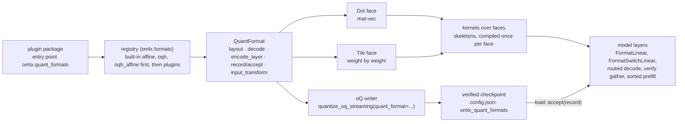

# Quant-format plugins: design overview

This page summarises the quant-format plugin interface on this fork's `quant-plugins-poc` branch. The contract itself, with every rule and error message, is [quant-formats.md](quant-formats.md). The interface is not part of upstream oMLX. Its contract revision 1 is unreleased and can still change ([Versions](quant-formats.md#versions)).

## Why

A quant format is how a quantized linear's tensors decode into weights. Without a plugin interface, a new format means changing oMLX itself: its loader, its writer and each fused kernel that should run it. The interface moves that work into an installed package:

- **No fork.** A package registers a format through the `omlx.quant_formats` entry point. oMLX finds it at the registry's first use. Nothing in oMLX changes.
- **One kernel family per route.** A fused kernel is a skeleton: it owns the launch shape, the walk over the inputs and what is fused around the product. A format supplies a *face*, a small Metal struct with the loads and arithmetic of one run of weights. Each kernel is compiled once per face, with the face inlined. A kernel tuned once runs every format that has the face, and a format costs what its own arithmetic costs ([Quant formats](quant-formats.md#quant-formats)).
- **Stock formats on the same path.** MLX's affine quantization (oQ and oQe checkpoints) registers through the same `register`, as a built-in. The fused kernels read affine weights through the affine face, which is MLX 0.32.4's `quantized.h` code, so each row has MLX's bits ([Affine](quant-formats.md#affine)).

## How a format plugs in



A format is a `QuantFormat` with a `mode` (the per-layer `mode` in the quantization config), a codes tensor, side tensors and the contract revision it targets ([Register a format](quant-formats.md#register-a-format)). Its methods:

- `layout(k, n, bits, group_size)`: shape and dtype of each tensor of one `(n, k)` matrix, or `None` for a matrix it does not keep.
- `decode`: the float reference, run where no kernel takes the rows and used by tests ([Decode](quant-formats.md#decode)).
- `encode_layer`: the tensors oQ writes, given oQe's per-input importance and an `EncodeContext`. It is the only writer hook; a format may also declare `shared_tensors` (layer-wide unstacked tensors) and an `InputTransform` (one rotation every route applies, with optional fused producer specs), documented in [quant-formats.md](quant-formats.md#shared-tensors-and-the-input-transform). Built-in `oqh` and `oqh_affine` register beside `affine` using the same contract.
- `record` / `accept`: a checkpoint's own parameters (a fitted level table, say), and a reader configured from them at load.
- `dot` / `tile`: the faces for a layer, or `None`.

A `Dot` face is a per-lane cursor (`Lanes<K>`: `load`, `madd`, `finish`, and `decode`/`apply` to share a block's weights across input vectors). A `Tile` face is a per-row cursor (`Runs<K>`: `params`, `fetch`, `weight`) that decodes runs of 8 codes into threadgroup tiles. Lookup tables are declared as `Table` data, and oMLX stages them for the GPU it runs on ([Faces](quant-formats.md#faces), [Tables](quant-formats.md#tables)).

Routes built on faces ([Kernels built on faces](quant-formats.md#kernels-built-on-faces)):

| Route | Face |
|---|---|
| Format layers: decode steps and short blocks (1 to 16 rows), switch-layer pairs | dot |
| Qwen3.5-family one-token MoE decode, routed and shared experts | dot |
| Qwen3.5-family verify blocks of 2 to 8 rows, routed experts | dot |
| Sorted prefill of format switch layers, tensor-unit GPUs (M5, NAX), with fused SwiGLU | tile |
| Sorted prefill of format switch layers, M3 (steel gather) | tile |

oQ writes a format with `quantize_oq_streaming(..., enhanced=True, quant_format=...)`, given a mode or a configured format object. It offers the matrices oQe has importance for, held by `nn.Linear` or the mlx-lm/mlx-vlm `SwitchLinear`. Declined matrices stay oQ's affine. oQ checks each `encode_layer` result against `layout` and asks for both faces of each encoded layer. It writes to `<output>.unverified`, loads the staged checkpoint, runs a forward, records `omlx_verification` and `omlx_quant_formats` (plugin, contract, record) in `config.json`, and renames the folder ([Quantize a checkpoint](quant-formats.md#quantize-a-checkpoint)).

## What oMLX guarantees, and what it refuses

A format that cannot be shown right is refused, or its layers fall back to a slower composed path.

- **Registration**: one format per mode. Built-ins register first and cannot be replaced. MLX's own modes (`affine`, `mxfp4`, `mxfp8`, `nvfp4`, ...) are reserved for built-ins. A plugin's tensors may not be named `weight`, `scales`, `biases` or `bias`, so code that reads MLX's tensors by hand fails loudly. A plugin that fails to import is logged and skipped, and the server starts ([Register a format](quant-formats.md#register-a-format)).
- **Contract**: a format states its revision in `contract`, each face in `CONTRACT`. A revision outside `OLDEST_CONTRACT..CONTRACT` is refused at registration. A face of another revision fails one `static_assert`. A new revision is an addition, and earlier formats run as before, to the bit ([Versions](quant-formats.md#versions)).
- **Stability**: `omlx.formats.CONTRACT_STABILITY` is `"experimental"` while the interface is unreleased. It sits beside `CONTRACT = 1` and `OLDEST_CONTRACT = 1`; before upstream freezes the contract there are no backward-compatibility shims, and the value becomes `"stable"` when it does.
- **Load**: every refusal is one `FormatRefusedError` naming the mode, the checkpoint, the plugin that wrote it and the one installed. Refused: a format not installed, a record `accept` rejects, a layer filled in part, a checkpoint not recorded as verified, a family outside the verified allowlist in `omlx/oq.py` (which oQ applies too). A layer never computes on a placeholder ([Load a checkpoint](quant-formats.md#load-a-checkpoint)).
- **Runtime**: a `dot()` or `tile()` that raises or returns an invalid face counts as `None`, logged once. Each kernel proves its Metal on a zero stand-in before its first real launch. A face that fails to compile is logged, and its layers keep the composed path or `decode` ([Kernels over faces](quant-formats.md#kernels-over-faces)).
- **Compile time**: face sources are C++17 Metal without derived classes. Skeleton `static_assert`s name the broken rule. A face source with a static-storage array is refused: tables are `Table` data, because per-lane reads from `constant` or `device` memory varied 2 to 7% in speed between processes on an M3 Ultra ([Compile-time rules](quant-formats.md#compile-time-rules), [Tables](quant-formats.md#tables)).
- **Exactness**: kernels compile with fast math off. A dot row is a function of the row and the input alone, and `apply(decode(r))` equals `madd(r)` bit for bit, so each vector of a shared-rows launch has the bits of its one-vector call ([The dot face](quant-formats.md#the-dot-face)). A tile `weight` is the format's `decode` in float32, bit for bit, rounded once to the activation type ([The weight](quant-formats.md#the-weight)). The documented exception: an ordinary Qwen dense call of two or more rows through the wide mat-vec kernel can change low bits against each row alone. Row-exact calls, MTP verification included, keep single-row bits ([Layers](quant-formats.md#layers)).

## What a format author writes

The reference's own example, 8-bit codes with one float scale per row:

```python
import mlx.core as mx
from omlx.formats import (
    ApplyRead,
    Dot,
    DotReads,
    LoadRead,
    MaddRead,
    QuantFormat,
    TypeParam,
)

class MyFormat(QuantFormat):
    mode = "myformat"
    codes_name = "codes"
    tensors = ("group_scales",)
    contract = 1

    def layout(self, k, n, bits, group_size):
        if bits != 8:
            return None
        return {"codes": ((n, k), mx.uint8), "group_scales": ((n,), mx.float32)}

    def decode(self, tensors, bits, group_size): ...
    def encode_layer(self, w, importance, context): ...

    def dot(self, layer, k, n):
        if k % 8:  # K must be whole runs of the face's VPT (8)
            return None
        return Dot(
            key="myformat_b8",
            source=SOURCE,
            type="omlx_myformat_b8::Dot",
            tensors=("group_scales",),
            reads=DotReads(
                load=LoadRead(input=TypeParam("XP")),
                madd=MaddRead(params=("acc", "r", "xt", "")),
                apply=ApplyRead(aux=TypeParam("A")),
            ),
        )

FORMAT = MyFormat()
```

```toml
[project.entry-points."omlx.quant_formats"]
myformat = "my_package:FORMAT"
```

`SOURCE` is a Metal struct of about 50 lines ([An example](quant-formats.md#an-example), [An example of a tile face](quant-formats.md#an-example-of-a-tile-face)). `omlx.formats.testing` checks the face rules that can be tested at runtime (`dot_rows`, `shared_rows`, `lane_parts`, `finish_rows`, `tile_rows`, `codes_rows`, `check_constructor_reads`, `staged_tables`, `rows_stack`) ([Test a format](quant-formats.md#test-a-format)).

[omlx-oqel](https://github.com/yohann-bearzi/omlx-oqel) is a complete plugin: Lloyd-codebook formats at 2, 3 and 4 bits, with a scale byte per group of 16 and a bfloat16 row scale. Its level tables are `Table`s, fitted tables travel in the checkpoint record, and `accept` builds a reader from that record. It gives dot and tile faces.

## Scope and status today

On the interface now:

- oQ writes, and oMLX loads, format checkpoints for one family: `qwen4_exp` (Qwen3.8 Flash-Next). Tests can mark tiny checkpoints of other families as verified with `testing.verified`.
- The first real checkpoint is Qwen3.8 Flash-Next with its routed experts in oQeL and the rest oQ4e: written by oQ, loaded, and measured for quality and speed (figures in the omlx-oqel README).
- The routes in the table above. The fused routed decode takes a format's experts only when the gate+up face is exact for exactly one activation dtype; otherwise the block keeps its composed path.

Not yet:

- Other families. GLM-5.2, GLM-5.3, DeepSeek V4, Inkling 2, Raon-1 mini and Clef are refused by name for hand-written readers. DeepSeek V4.1 and Muse Spark use writers of their own.
- Layer types other than `nn.Linear` and `SwitchLinear` (MLA's `MultiLinear`, a family's own switch layer). oQ writes them affine.
- Dense prefill: a dense format linear's calls above 16 rows that no tile or row-exact route takes run `decode`, then MLX's matmul. Correct, and slow.
- Distributed serving (cluster, tensor and pipeline parallel), custom `model_file` models, external drafters, and embedding, reranking and audio readers refuse format checkpoints. MoE expert offload keeps every expert resident.
- Formats whose product is not row by row over blocks of inputs need a new kind of face ([Add to the contract](quant-formats.md#add-to-the-contract)).

## Developer tooling: audit and debug CLIs

`python -m omlx.formats.audit <paths...>` statically scans Python sources for hand-written reads that bypass the format interface: `.weight`, `.scales` and `.biases` on a layer, `mx.quantized_matmul`, `mx.dequantize`, `mx.gather_qmm`, and exact `type(x) is QuantizedLinear` comparisons. A hit is a place where a family's code would misread a format layer; the scan is the check a family port runs before it is declared supported. The scanner is pure Python (it imports no `mlx`), so it also runs on an MLX-free host as `python omlx/formats/audit.py <paths...>`.

- Rules: `unguarded-weight`, `unguarded-scales`, `unguarded-biases`, `unguarded-quantized-matmul`, `unguarded-dequantize`, `unguarded-gather-qmm` and `exact-type-check`.
- Flags: `--exclude GLOB` (repeatable), `--allow SPEC` (repeatable, `PATH[:SCOPE][=RULE]::REASON`), `--format text|json`, and `--check-unused-pragmas`.
- Exit codes: `0` clean; `1` findings, unparsable files, or (with `--check-unused-pragmas`) an unused pragma; `2` a usage error, a missing path or a bad `--allow`.

A hit can be allowed inline, on the finding's line, the line above it, or the closing line of a multi-line call; `allow-file` in the leading header covers the whole file. The pragma is parsed from the comment, and malformed syntax, an unknown rule or a missing reason fails closed with an `invalid-pragma` finding that no pragma or allowlist entry can suppress:

    # omlx-audit: allow[unguarded-weight, unguarded-scales] -- reason
    # omlx-audit: allow -- reason          (every rule)
    # omlx-audit: allow-file[rule, ...] -- reason
    # omlx-audit: allow-file -- reason

For pytest, `omlx.formats.audit.assert_no_unguarded_readers(paths, *, exclude=(), allowlist=(), check_unused_pragmas=False)` raises `AuditError` carrying the report; each `AllowEntry(path, rule="*", scope="*", reason=...)` needs a non-empty reason. `scan_paths` and `scan_source` return the same `AuditReport` without raising, and `format_report(report, fmt=...)` renders it as text or JSON.

## Backend requirements and non-Metal extension hook

Format layers are Metal: every face and skeleton compiles to a Metal kernel, so a format layer constructs only where the runtime provides Apple Metal. `omlx.formats.metal_backend_available()` reports whether it does, and `require_metal_backend(mode, ...)` raises one `FormatRefusedError` naming the mode, the checkpoint and the installed plugin when it does not. The check runs once, in `_may_build` at the start of a verified checkpoint load and in the constructor of every format layer; the forward path is unchanged, so there is no per-call cost. On a CPU-only, CUDA, ROCm or Vulkan MLX build, or one without `mx.fast.metal_kernel`, construction fails closed instead of falling back to a slow or wrong path. Registration, `Dot`/`Tile`/`Codes`/`Table` descriptors and `omlx.formats.audit` stay usable without Metal.

**Future `CONTRACT >= 2`: a non-Metal backend emitter (sketch).** Serving CUDA, ROCm, Vulkan or the CPU means compiling a face for that backend instead of for Metal. The planned hook is a `BackendEmitter` per backend: `backend`, `is_available()`, `emit_reads(reads)` over the same `reads.py` descriptors a face already declares, `emit_tables(tables)` over its `Table`s, and `build_skeleton(...)` for the kernel around them. Faces gain a backend key beside their contract revision, `require_supported_backend(fmt, mode)` replaces the Metal-only check at construction, and tuning tables are keyed by `(backend, chip)`. This is a sketch, not a contract: it is written down so backend-independent face descriptors stay the interface.

## Where to read next

- [Register a format](quant-formats.md#register-a-format), [Versions](quant-formats.md#versions): the package-level contract.
- [The dot face](quant-formats.md#the-dot-face), [The tile face](quant-formats.md#the-tile-face), [Tables](quant-formats.md#tables): what a face must satisfy.
- [Kernels over faces](quant-formats.md#kernels-over-faces), [Kernels built on faces](quant-formats.md#kernels-built-on-faces): how kernels are built and proven.
- [Load a checkpoint](quant-formats.md#load-a-checkpoint), [Quantize a checkpoint](quant-formats.md#quantize-a-checkpoint): the checkpoint lifecycle.
- [Test a format](quant-formats.md#test-a-format), [Affine](quant-formats.md#affine): the checks, and the built-in format as a worked case.
